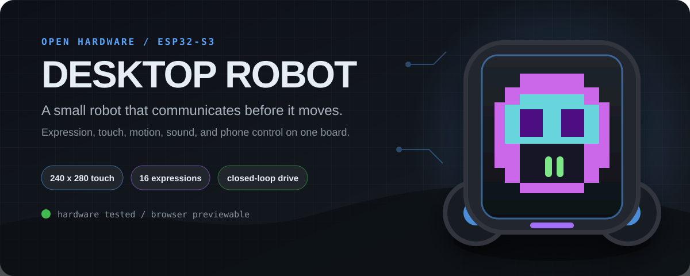
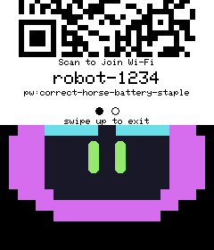
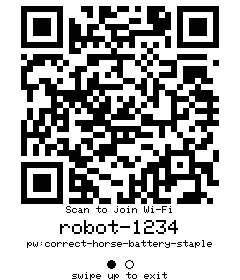
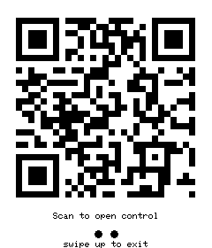
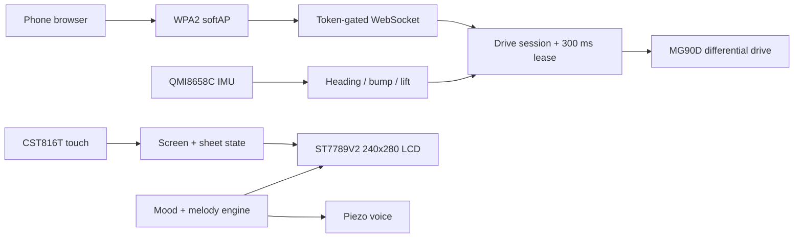

<p align="center">
  
</p>

<p align="center">
  
  
  
  
</p>

<p align="center">
  <strong>A small robot that communicates before it moves.</strong><br>
  Expressive eyes, touch-first pairing, closed-loop turns, sound, and a phone control surface -
  all on one ESP32-S3.
</p>

<p align="center">
  <a href="#build-it">Build it</a>
  &nbsp;&middot;&nbsp;
  <a href="#develop-the-ui-without-the-robot">Preview the UI</a>
  &nbsp;&middot;&nbsp;
  <a href="docs/ENGINEERING-GUIDE.md">Engineering guide</a>
  &nbsp;&middot;&nbsp;
  <a href="HARDWARE.md">Hardware reference</a>
</p>

> [!CAUTION]
> **Never drive the robot while it is plugged into USB.** The cable restrains the
> chassis, invalidates movement measurements, and can pull the robot off the desk
> or damage the connector. Untethered bench runs deliberately require a physical
> on-screen confirmation.

## What this is

Desktop Robot is an open hardware companion built around the
[Waveshare ESP32-S3-Touch-LCD-1.69](https://www.waveshare.com/wiki/ESP32-S3-Touch-LCD-1.69).
It combines an immediate-mode LCD face, differential-drive motion, inertial
sensing, a piezo voice, capacitive touch, and a temporary Wi-Fi control app.

The project is designed as a measured engineering system rather than a demo:
hardware limits are documented, safety paths are host-tested, rejected
approaches are recorded, and the real display code can run in a browser without
the robot attached.

<table>
  <tr>
    <td align="center" width="25%">
      <br>
      <sub><strong>Live expression engine</strong><br>16 moods, gaze, blink, and brows</sub>
    </td>
    <td align="center" width="25%">
      <br>
      <sub><strong>Direct manipulation</strong><br>1:1 touch tracking and snap physics</sub>
    </td>
    <td align="center" width="25%">
      <br>
      <sub><strong>Scan to join</strong><br>Temporary WPA2 softAP pairing</sub>
    </td>
    <td align="center" width="25%">
      <br>
      <sub><strong>Scan to control</strong><br>Token-gated WebSocket app</sub>
    </td>
  </tr>
</table>

## Highlights

| | |
|---|---|
| **Expressive by default** | A standalone `EyeEngine` renders 16 moods, directional gaze, blinking, idle wander, brows, eye shapes, and color transitions. |
| **Motion with feedback** | Two continuous-rotation MG90D servos provide differential drive; the QMI8658C gyro closes the loop for measured turns and heading hold. |
| **Touch-to-pair control** | Pull down the LCD sheet to start a temporary softAP, scan two QR codes, and control the robot from a phone with binary WebSocket frames. |
| **Safety is independent** | A 300 ms drive lease, hardware timer trip, motor-rail gating, protocol quarantine, bump detection, and lift detection fail safe without relying on the browser. |
| **UI development without hardware** | Native and WebAssembly harnesses compile the same Arduino_GFX, QR, eye, screen, and sheet-transition code used by the firmware. |
| **Evidence over folklore** | Timing limits, drift, coast, calibration, rejected ideas, and open risks are kept as measured records in `docs/`. |

## System architecture



## Hardware

| Subsystem | Part | Notes |
|---|---|---|
| Controller | ESP32-S3R8 | Dual-core 240 MHz, 8 MB OPI PSRAM, 16 MB flash |
| Display | ST7789V2 | 240x280 IPS, 40 MHz SPI, 20 px row offset |
| Touch | CST816T | Capacitive touch and gestures over shared I2C |
| Motion sensing | QMI8658C | 6-axis IMU used for yaw, heading hold, bump, shake, and lift |
| Drive | 2x MG90D continuous rotation | Differential drive with calibrated pulse curves |
| Sound | Passive piezo | Mood-linked generated melodies and direct tone control |
| Power | LiPo + external 5 V servo rail | Latched board power and state-gated buck-boost enable |

The authoritative pin map, power design, measured constants, and electrical
gotchas live in [`HARDWARE.md`](HARDWARE.md).

## Build it

### Requirements

- [PlatformIO Core](https://docs.platformio.org/en/latest/core/installation/index.html)
- A Waveshare ESP32-S3-Touch-LCD-1.69
- Two continuous-rotation MG90D servos and the external 5 V servo supply
- Windows PowerShell for the bundled host-test runner

### Firmware

```powershell
git clone https://github.com/Nicolassalazar-pro/desktop-robot.git
cd desktop-robot

pio run
pio run -t upload --upload-port COMx
pio device monitor -p COMx -b 115200
```

For the first flash, hold **BOOT**, tap **RESET**, release **BOOT**, then run the
upload command. The board uses native USB CDC rather than a USB-to-UART bridge.

### Tests

```powershell
powershell -NoProfile -ExecutionPolicy Bypass -File test\run_motor_host_tests.ps1
```

The runner builds and executes 18 native host suites and the Python contract
suite. Movement accuracy still requires the documented untethered, supervised
bench workflow; software tests cannot validate wheel slip or a physical turn.

## Develop the UI without the robot

The offline preview pipeline compiles the **same source files** as the firmware.
There is no JavaScript or Python reimplementation to drift.

```powershell
# Static, byte-stable PNG/PPM renders
powershell -File tools\host_preview\build.ps1

# Interactive browser preview with live eyes and real sheet physics
powershell -File tools\web_preview\build.ps1
powershell -File tools\web_preview\serve.ps1
```

Open <http://localhost:8770>. Screen 4 previews pull-down pairing; screen 5
previews drag-to-dismiss and exposes a staging counter for diagnosing layer
replacement bugs.

The companion simulator serves the real firmware web app with a fake robot
behind it:

```powershell
powershell -File tools\web_preview\serve_app.ps1
```

See [`tools/web_preview/README.md`](tools/web_preview/README.md) for LAN,
hotspot, QR, and WebSocket diagnostic workflows.

## Measured, not guessed

| Result | Evidence |
|---|---|
| LCD runs at **40 MHz**, not 80 MHz | ST7789V2 serial timing caps writes at 62.5 MHz; 80 MHz violates cycle and pulse-width minimums |
| Stationary heading stayed inside **+/-0.33 deg for two minutes** | Two independent runs with all-axis zero-velocity bias updates |
| Browser control is healthy at **33-34 frames/s** | 30 ms sender cadence measured by the host simulator with sequence-gap counting |
| Full-screen LCD push is about **32.5 ms at 40 MHz** | On-device `lcdbench`; throughput is byte-bound rather than call-bound |
| Touch coordinates use the **identity mapping** | Measured raw X/Y motion independently; gesture direction was not used as a coordinate proxy |

The derivations, failed hypotheses, and bench records are preserved instead of
being compressed into confident comments. Start with
[`docs/PROJECT-HISTORY.md`](docs/PROJECT-HISTORY.md).

## Repository map

| Path | Purpose |
|---|---|
| [`src/`](src/) | Firmware, display screens, motion state, pairing flow, and generated assets |
| [`lib/EyeEngine/`](lib/EyeEngine/) | Reusable expressive eye renderer |
| [`body models/`](body%20models/) | Printable meshes, 3MF assembly, and native Fusion source |
| [`tools/host_preview/`](tools/host_preview/) | Native pixel-exact LCD renderer |
| [`tools/web_preview/`](tools/web_preview/) | WebAssembly LCD preview and phone-app simulator |
| [`test/`](test/) | Native unit suites, stubs, and Python contract tests |
| [`docs/`](docs/) | Engineering history, bench evidence, research, and review findings |
| [`datasheets/`](datasheets/) | Vendor reference material used for hardware decisions |

## Documentation

| Read this | When |
|---|---|
| [`docs/ENGINEERING-GUIDE.md`](docs/ENGINEERING-GUIDE.md) | Serial commands, calibration, motion research, bench workflows, and detailed operation |
| [`HARDWARE.md`](HARDWARE.md) | Wiring, power, timing, pin assignments, and board-revision traps |
| [`docs/PROJECT-HISTORY.md`](docs/PROJECT-HISTORY.md) | Before proposing a major change; it records already-rejected approaches |
| [`docs/key-issues/`](docs/key-issues/) | Reliability, security, performance, design, testing, and dependency review findings |
| [`docs/mcu-ui-tooling-landscape.md`](docs/mcu-ui-tooling-landscape.md) | Research on desktop/browser preview tooling for immediate-mode MCU displays |
| [`CONTRIBUTING.md`](CONTRIBUTING.md) | How to make a safe, reviewable contribution |

## Security model

The robot does not join an existing network during phone control. It creates a
temporary WPA2 softAP and displays its credentials locally. A separate random
64-bit activation token gates HTTP and WebSocket access. Seeing the screen is
the intended physical-presence trust boundary.

The fixed AP passphrase is therefore **discoverable by design**, not the drive
authorization secret. Known residual risks and the full threat analysis are in
[`docs/key-issues/SEC.md`](docs/key-issues/SEC.md). Report new vulnerabilities
privately through
[GitHub Security Advisories](https://github.com/Nicolassalazar-pro/desktop-robot/security/advisories/new).

## Contributing

Contributions are welcome, especially focused fixes with a measurement or a
host test. Please read [`CONTRIBUTING.md`](CONTRIBUTING.md) and the rejected
approaches in `docs/PROJECT-HISTORY.md` before changing hardware timing, drive
safety, touch mapping, or WebSocket ownership.

## License

- Software, scripts, and project-authored documentation: **MIT**
- CAD and hardware design source under `body models/`: **CERN-OHL-S-2.0**
- Third-party dependencies and vendor documents retain their own licenses
- Microsoft Garage names and logo artwork are used with authorization and are
  not licensed for reuse under the project licenses

See [`LICENSE.md`](LICENSE.md) and
[`THIRD_PARTY_NOTICES.md`](THIRD_PARTY_NOTICES.md) for the exact scope.

---

<p align="center">
  Built as a real robot, documented as a reproducible system.
</p>
